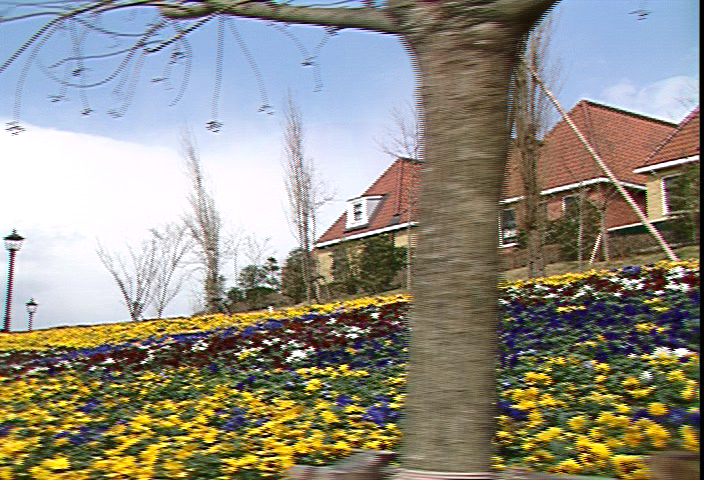
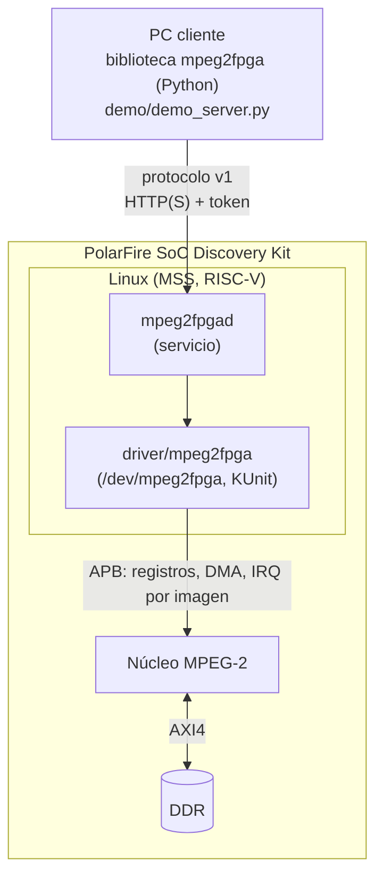
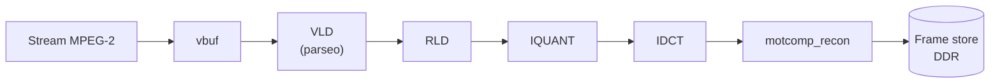

# mpeg2fpga sobre PolarFire SoC

Port de **mpeg2fpga** — un decoder MPEG-2 (ISO/IEC 13818-2) en Verilog de código abierto,
originalmente orientado a Xilinx, por Koen De Vleeschauwer — a un **Microchip PolarFire SoC**,
controlado desde Linux y empaquetado como producto: driver de kernel, servicio de red con protocolo
versionado, biblioteca cliente en Python y releases firmadas que se califican en el hardware real
antes de publicarse.

**Demo pública:** [esbon125.github.io/tandem](https://esbon125.github.io/tandem/) — se sube un video
desde el navegador y lo decodifica la FPGA.



## Estado

- **Conformidad.** Los 37 flujos MPEG-2 de conformidad difieren del decoder de referencia
  (`tools/mpeg2dec`) sólo en lo que admite la norma: 3 bit a bit idénticos y 34 dentro del margen de
  la IDCT (peor error medio 0,038 sobre 255). Hicieron falta dos correcciones de tres líneas al RTL
  original: el redondeo del promedio de predicciones en `motcomp_recon.v` y el orden de las matrices
  de cuantización en `iquant.v` (bitácora `docs/bringup/50`). La IDCT cumple IEEE 1180-1990.
- **El port no agrega diferencias.** El mismo flujo por simulación (Icarus Verilog) y por la placa
  deja una memoria de cuadros idéntica byte a byte.
- **Velocidad.** 20–23 imágenes/s en definición estándar (704×480) y 53,7 en CIF, más del doble del
  tiempo real; de punta a punta, por red y a través de la biblioteca, ~19–20 imágenes/s. El límite
  restante es la reconstrucción del núcleo original. Consumo estimado del decoder: 68 mW.
- **Producto.** Cada release trae el bitstream, el paquete de la placa, el wheel de Python, la guía
  de usuario en castellano e inglés, el manual de referencia, el protocolo v1 y `SHA256SUMS`,
  firmados con la clave Ed25519 del proyecto. Ver [Releases](https://github.com/esbon125/tandem/releases).

## Arquitectura



El núcleo es un pipeline de streaming de ancho fijo (`doc/mpeg2fpga.txt` §2.2.1 tiene el diagrama
completo):



## Estructura del repositorio

Tres ramas de trabajo de larga vida, una por tipo de contenido, más `master` como punto de
integración de las releases:

```
trunk/mpeg2fpga/     rama hardware_development — núcleo Verilog del decoder
  rtl/mpeg2/         RTL del decoder (IP de terceros, ver rtl/LICENSE-MPEG2)
  bench/             testbench funcional (Icarus Verilog) y test IEEE 1180
  soc_build/         síntesis, place & route y programación con Libero, sin interfaz gráfica
  tools/regress/     regresión en la placa: conformidad, determinismo, robustez, velocidad
  tools/framecmp/    comparación de frames contra el decoder de referencia
  tools/mpeg2dec/    decoder de referencia en C

driver/              rama firmware_development — módulo de kernel (KUnit)
daemon/              rama firmware_development — mpeg2fpgad, el servicio de red
api/                 rama firmware_development — protocolo v1 y biblioteca Python
demo/                rama firmware_development — servidor de la demo pública
user-guide/          rama firmware_development — guía de usuario (castellano e inglés)
release/             rama firmware_development — calificación, firma y empaquetado

docs/                rama docs — Informe Final, bitácoras de bring-up, referencias
```

## Usarlo

Con una placa instalada (guía de usuario, capítulo de instalación):

```python
from mpeg2fpga import Device

dev = Device("192.168.18.5", token=open("token").read().strip())
for frame in dev.decode("clip.m2v"):    # orden de presentación, planos I420
    print(frame.display_index, frame.picture_type, frame.width, frame.height)
```

Simulación, sin placa:

```sh
cd trunk/mpeg2fpga/bench/iverilog && make clean test
cd trunk/mpeg2fpga/bench/ieee1180 && make quick
```

## Releases

Cada release corre `release/qualify.sh` en la máquina conectada a la placa (regresión completa y
prueba de punta a punta contra una línea de base grabada); sólo si pasa, fusiona en `master`
exactamente los commits calificados de las tres ramas, los taggea (`vX.Y.Z` y `vX.Y.Z-<rama>`) y
publica los artefactos firmados. Detalle en `release/README.md`.

Para verificar una release, con la clave pública de `release/keys/`:

```sh
openssl pkeyutl -verify -pubin -inkey mpeg2fpga-release.pub.pem \
    -rawin -in SHA256SUMS -sigfile SHA256SUMS.sig
sha256sum -c SHA256SUMS
```

## Licencias

El software es MIT (`LICENSE`), el driver GPL-2.0 y el RTL propio CERN-OHL-S-2.0; el detalle por
componente está en `LICENSES.md` y lo que acompaña a cada release, en `THIRD_PARTY_NOTICES.md`.

- El núcleo MPEG-2 (`trunk/mpeg2fpga/rtl`) es IP de terceros bajo `rtl/LICENSE-MPEG2`.
- La IP de Microchip generada por Libero (`trunk/mpeg2fpga/mpeg2fpga/component/`) es propietaria;
  no se trackea en git y no debe redistribuirse sin autorización de Microchip.
